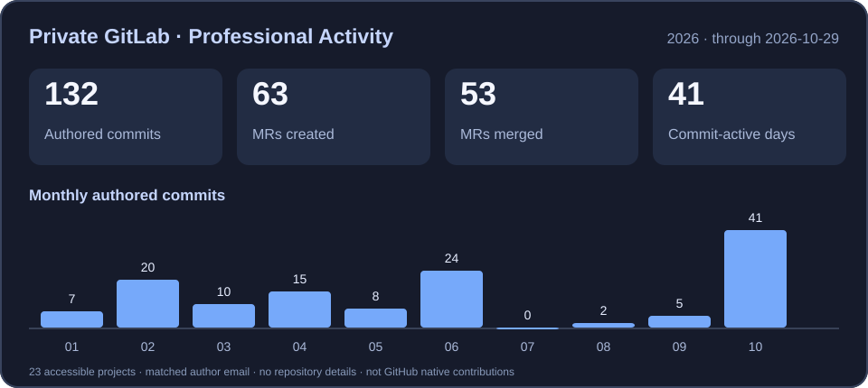

<!-- GitHub Profile README | DanickBG -->
<div align="center">
  

  Hi there 👋 I'm DanickBG!
  DevOps & Full-Stack Engineer · Former Data Science / Business Intelligence Developer · Physics Postgraduate
  <p>_"If you can't explain it simply, you don't understand it well enough"._</p>

</div>

<p align="center">
  
</p>

```python
👨‍💻 About Me
name:                 DanickBG
current_role:         DevOps & Full-Stack Engineer
Previous_experience:  Data Science / Business Intelligence Developer
Education:            Postgraduate in Physics
Focus in {
    - Cloud infrastructure, platform engineering & automation
    - Full-stack development and API integrations
    - AI agents, MCP servers & practical open source
    - Observability, identity & access management
}
```

Some of the Tools & Technologies I use are:
<p>
  
  
  
  
  
  
  
</p>


And my main Languages & Frameworks are:
<p>
  
  
  
  
  
  
  
  
</p>


<sub>And more...</sub>

⭐ Featured Open-Source Project

Developed around the Berlin Healthcare Hackathon 2026, the project attracted significant audience interest during and after the event. The integration was successfully demonstrated working with the Isaree ecosystem.

<div align="center">

[](https://github.com/DanickBG/GKV-Kartenleser-mit-Isaree)

</div>

📊 Professional Development Activity — Private GitLab
<p align="center">
  
</p>

<sub>Based on 23 accessible private GitLab projects, MRs created and MRs merged are separate date-based totals. This is a snapshot, not live data or a GitHub contribution counter. Company repository names, code and internal links are and will not published.</sub>

📈 GitHub Stats — GitHub Stats Extended Wizard

<div align="center">
  <a href="https://github.com/DanickBG">
    
  </a>
  
  <a href="https://github.com/DanickBG?tab=repositories">
    
  </a>
</div>

<p align="center"><sub>If the third-party stats cards are unavailable, you can always view my <a href="https://github.com/DanickBG">GitHub activity</a> and <a href="https://github.com/DanickBG?tab=repositories">repositories</a> directly.</sub></p>

<div align="center">
  
</div>
